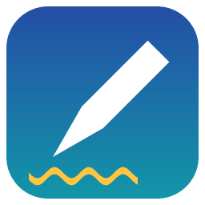

# Calame

Application de bureau **open source** de prise de notes manuscrites, écrite entièrement en **Rust**,
pensée pour les stylets (Wacom, Surface Pen…) et les tablettes graphiques. Elle fonctionne aussi à la
souris et au tactile. Cibles : Windows (priorité), Linux, macOS.

> Le calame est le roseau taillé qui servait de plume dans l'Antiquité.



**État : version 1.0.** Les notes sont stockées localement, sans compte ni
connexion. Voir les [limites connues](#limites-connues).

## Fonctionnalités

**Notes**
- Bibliothèque d'accueil : reprendre la dernière page, note rapide, pages récentes, couvertures des cahiers
  filtrables par matière, favoris ; dossiers imbriqués sans limite et pages en miniature.
- Recherche et commandes au clavier (Ctrl K) ; créer, renommer, dupliquer, réordonner, glisser-déposer,
  corbeille avec restauration.
- Enregistrement automatique ; sauvegarde et restauration complètes de la bibliothèque (zip).

**Dessin**
- Canevas vectoriel : zoom, déplacement, page infinie en hauteur. Annuler/rétablir illimités.
- Stylo sensible à la pression (lissage, coins nets), surligneur ; dock d'outils flottant et trousse de
  stylos préréglés ; mode concentration (F11).
- Gomme de trait entier ou de zone ; lasso (déplacer, redimensionner, pivoter, copier, coller,
  recolorer) ; zones de texte ; pipette.
- Couleurs : palette, favoris, sélecteur HSV, saisie hexadécimale.
- **Formes parfaites** : droite, cercle, ellipse, rectangle, carré, triangle, flèche, polygone, courbe
  lissée, par maintien du stylet ou bouton. Un Ctrl+Z rend le trait d'origine. Tout est local.
- **Instruments** : règle graduée, équerres, rapporteur, compas ; le trait se cale sur leur bord.

**Pages et fichiers**
- Fonds de page : uni, petits et grands carreaux, lignes, pointillés, isométrique, image.
- Import d'un PDF pour l'annoter ; import d'images en fond.
- Export d'une page, d'un cahier, d'un dossier ou d'une matière en PDF vectoriel, PNG ou SVG.
- Thèmes clair et sombre (encre éclaircie à l'affichage sur papier sombre) ; interface en français,
  polices Instrument Sans et Bricolage Grotesque.

## Installer

Les paquets sont publiés sur la page des versions du dépôt, quand une version est étiquetée :

- **Windows** : installeur `calame-<version>-setup.exe`, ou archive portable `calame-<version>-windows-x64.zip`
  (décompressez-la et lancez `Calame.exe`) ;
- **Linux** : paquet `.deb`, ou archive `.tar.gz` ;
- **macOS** : archive `.tar.gz` (non signée).

Les installeurs ne sont pas signés : Windows peut afficher un avertissement au premier lancement.

Les notes sont dans un fichier unique, `%APPDATA%\calame\Calame\data\calame.db` sous Windows. La
variable d'environnement `CALAME_DB` choisit un autre fichier.

## Compiler

Prérequis : Rust stable (https://rustup.rs).

```bash
cargo run -p calame-app --release   # lancer
cargo test --workspace              # tester
cargo build --profile dist -p calame-app   # binaire optimisé pour la distribution
```

Sous Windows, il faut soit les *Build Tools* de Visual Studio (cible `msvc`), soit un MinGW-w64 dans le
`PATH` avec la toolchain `stable-x86_64-pc-windows-gnu`. La première compilation est longue ; si le
compilateur manque de mémoire, limitez les tâches parallèles avec `CARGO_BUILD_JOBS=2`.

Construire les paquets : `scripts/package-windows.ps1` (archive portable et, si Inno Setup est
installé, installeur) ; le workflow `.github/workflows/release.yml` construit les trois plateformes.

## Structure

| Crate | Rôle |
|---|---|
| `calame-core` | Modèle de données (éléments, historique, arborescence, fonds, instruments), sans dépendance à l'interface |
| `calame-shapes` | Reconnaissance de formes, indépendante de l'interface |
| `calame-storage` | Stockage SQLite : bibliothèque, pages, images, réglages, sauvegarde zip |
| `calame-export` | Export SVG/PNG/PDF et import de PDF/images (`resvg`, `svg2pdf`, `hayro`) |
| `calame-input` | Types d'entrée unifiée souris/tactile/stylet ; accès natif au stylet à écrire |
| `calame-app` | Interface `egui`/`eframe`, canevas et outils |

## Documentation

- [Guide d'utilisation](docs/guide-utilisateur.md)
- [Architecture et performances](docs/architecture.md)
- [Format de stockage](docs/format.md)
- [Stylet et tablettes : état par plateforme](docs/stylet.md)
- [Contribuer](CONTRIBUTING.md) · [Journal des modifications](CHANGELOG.md)

## Limites connues

- **Stylet** : la pression passe par les événements tactiles de `winit`/`egui` ; elle a été vérifiée sous
  Windows seulement. Le bouton du stylet, l'extrémité gomme, l'inclinaison et le **rejet de la paume**
  ne sont pas pris en charge : ils demandent un accès natif (`WM_POINTER`, XInput2, `NSEvent`) pas
  encore écrit. Détails dans [docs/stylet.md](docs/stylet.md).
- **Reconnaissance d'écriture manuscrite** (notes cherchables) : non commencée.
- Les instruments (règle, compas…) ne sont pas enregistrés dans la note.
- La flèche reconnue se trace en un seul geste ; les PDF protégés par mot de passe ne s'importent pas.
- Linux et macOS : compilés par la CI, pas essayés avec un stylet. Sous Linux, les boîtes de dialogue de
  fichiers passent par le portail de bureau (`xdg-desktop-portal`), qui doit être installé.

## Licence

Double licence [MIT](LICENSE-MIT) ou [Apache-2.0](LICENSE-APACHE), au choix.

Les polices intégrées, [Instrument Sans](assets/fonts/OFL-InstrumentSans.txt) et
[Bricolage Grotesque](assets/fonts/OFL-BricolageGrotesque.txt), sont sous licence SIL Open Font
License 1.1 ; les fichiers de `assets/fonts` en sont des instances statiques (graisses 400, 500, 600
et 700).
